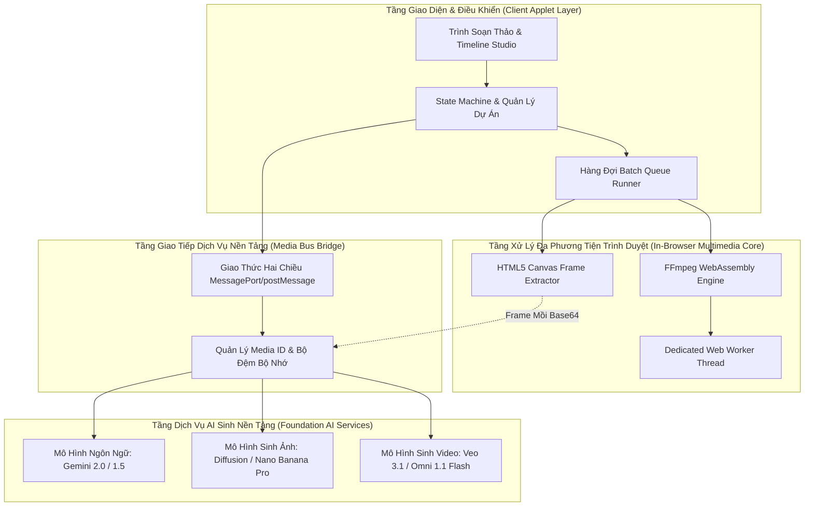
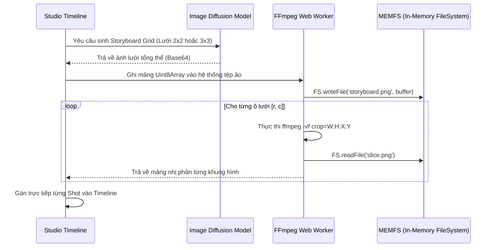
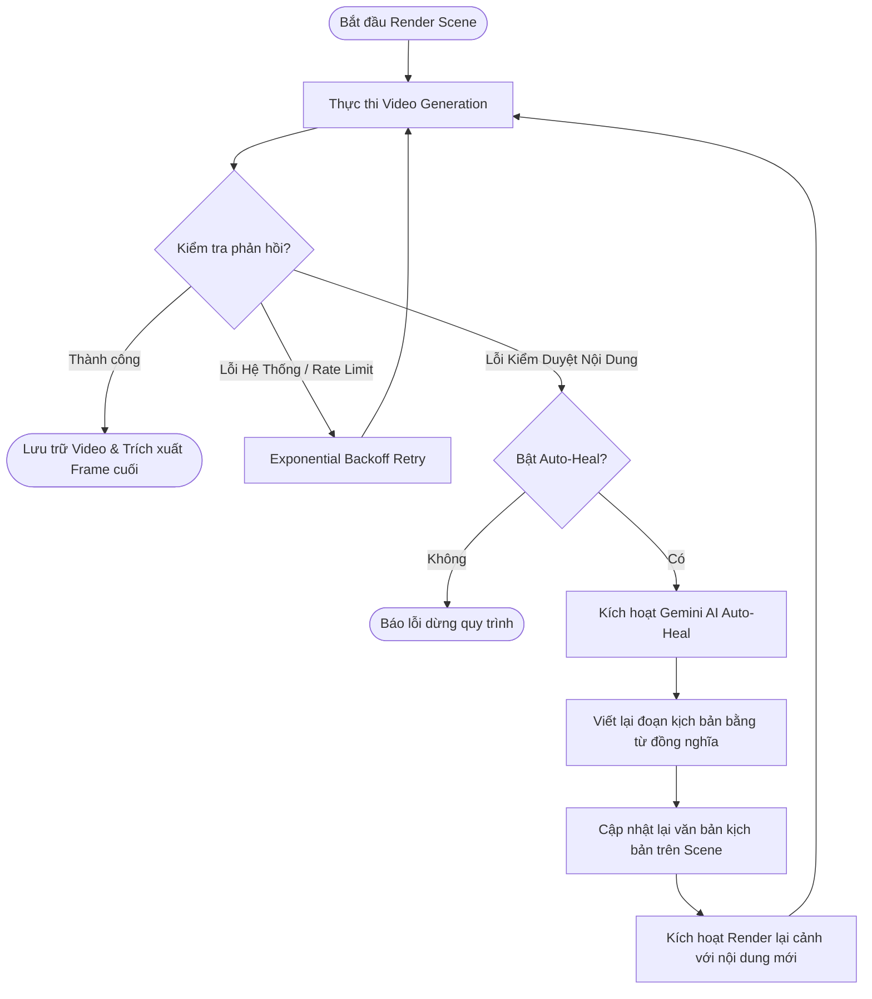

# 🎬 HỆ THỐNG SẢN XUẤT ĐIỆN ẢNH TỰ ĐỘNG BẰNG AI (AI CINEMATIC PRODUCTION PIPELINE)
## TÀI LIỆU ĐẶC TẢ KIẾN TRÚC & GIẢI PHÁP KỸ THUẬT TOÀN DIỆN (SYSTEM ARCHITECTURE & TECHNICAL SPECIFICATION)

---

## 1. TỔNG QUAN HỆ THỐNG (SYSTEM OVERVIEW)

Hệ thống **AI Cinematic Production Pipeline** là một nền tảng tự động hóa sản xuất phim ngắn và video điện ảnh đa cảnh (multi-scene narrative films). Hệ thống giải quyết các thách thức kỹ thuật lớn nhất trong lĩnh vực sản xuất video bằng AI hiện nay:
- **Tính nhất quán hình ảnh của nhân vật và bối cảnh (Identity & Environment Consistency)** xuyên suốt nhiều phân cảnh.
- **Tính liền mạch thời gian giữa các cảnh quay (Temporal & Visual Continuity)** thông qua kỹ thuật kết nối khung hình kế thừa (Frame Chaining).
- **Tự động xử lý đa phương tiện cục bộ (Zero-Server-Cost Multimedia Processing)** bằng cách nhúng trực tiếp WebAssembly FFmpeg và Canvas Engine vào trình duyệt.
- **Khả năng tự phục hồi kịch bản (Autonomous Self-Healing Resilience)** khi gặp rào cản từ các bộ lọc nội dung nhạy cảm của các mô hình nền tảng (Foundation Models).

---

## 2. KIẾN TRÚC TỔNG THỂ (HIGH-LEVEL ARCHITECTURE)



### 2.1. Cơ Chế Giao Tiếp Hai Chiều (Media Bus Bridge)
Ứng dụng được thiết kế chạy dưới dạng một môi trường độc lập (Sandboxed Realm). Để tương tác với tài nguyên phần cứng và các dịch vụ AI đám mây, hệ sinh thái sử dụng giao thức **Asynchronous MessageChannel**:
- **Luồng gửi (Request Loop):** Đóng gói yêu cầu kèm định danh duy nhất `requestId`, chuyển đổi dữ liệu nhị phân/base64 và phát tín hiệu qua `MessagePort`.
- **Luồng nhận (Event Loop):** Lắng nghe sự kiện trả lời (`FLOW_RESPONSE`), ánh xạ ngược lại Promise tương ứng trong bản đồ `idToPendingRequest`, hỗ trợ xử lý luồng streaming dữ liệu video/âm thanh và camera/microphone.

---

## 3. THIẾT KẾ CÁC PHÂN HỆ XỬ LÝ LÕI (CORE SUBSYSTEMS)

### 3.1. Phân Hệ Phân Rã & Cấu Trúc Kịch Bản (Script Breakdown Engine)
Hệ thống sử dụng kỹ thuật trượt cửa sổ (Sliding Window Chunks) để xử lý văn bản quy mô lớn mà không làm mất liên kết ngữ cảnh:
1. **Phân đoạn văn bản (Text Chunking):** Chia tác phẩm thành các khối từ 150 - 200 từ.
2. **Kỹ thuật Prompting cấu trúc hóa kịch bản:** Buộc mô hình ngôn ngữ lớn (LLM) trả về định dạng phân cảnh khép kín chuẩn điện ảnh (10 giây/scene):
   * Định danh cảnh duy nhất (`SCENE`).
   * Phân tích rõ ràng danh sách nhân vật tham gia và bối cảnh chuẩn xác.
   * Chi tiết từng Shot: Góc máy quay (Camera Angle), chuyển động máy (Movement), hành vi diễn xuất, biểu cảm vi mô (Micro-expressions) và lời thoại điện ảnh.

### 3.2. Động Cơ Định Danh & Nhất Quán Thực Thể (Visual Identity & DNA Engine)
Để giải quyết bài toán biến dạng nhân vật (Face/Character Drifting) giữa các cảnh quay:
1. **Trích xuất thực thể theo ngữ cảnh:** LLM phân tích 3 cảnh liên tiếp `[Scene_{i-1}, Scene_i, Scene_{i+1}]` để trích xuất JSON danh sách diễn viên (Tên chính, Tên gọi khác, Vai trò, Đặc điểm nhận dạng cốt lõi) và bối cảnh không gian.
2. **Bản đồ thị giác 360° (360° Visual Identity Bible):**
   * Tự động sinh ảnh thiết kế nhân vật độ phân giải cao trên phông nền xanh **Chroma Key**, bao gồm đồng thời 5 góc máy: *Chính diện, Góc 3/4, Góc nghiêng 90°, Phía sau lưng, và Cận cảnh đặc tả*.
   * Toàn bộ các đặc điểm nhân trắc học (kiểu tóc, màu mắt, nếp vải, cấu trúc xương) được cố định làm tài sản tham chiếu cơ sở (`referenceImageMediaIds`).
3. **Bản đồ bối cảnh kiến trúc (Environment Reference Sheet):**
   * Sinh ảnh toàn cảnh (Wide-angle Cinema View), mô tả kiến trúc, kết cấu ánh sáng, vật liệu và bố cục không gian mà không có sự hiện diện của nhân vật nhằm tránh gây nhiễu cho mô hình sinh video.

### 3.3. Cơ Chế Thích Ứng Sinh Trắc Học Đối Kháng (Adversarial Biometric Adaptation)
Khi tạo hình nhân vật ngẫu nhiên có nguy cơ vô tình trùng lặp với người nổi tiếng hoặc khuôn mặt có bản quyền, hệ thống tích hợp chu trình kiểm thử và đột biến hình ảnh:
1. **Kiểm thử sớm (Early Probing):** Tự động khởi tạo một video ngắn 4 giây độ phân giải thấp (360p) với mô hình tốc độ cao để thăm dò bộ lọc nhận diện sinh trắc học.
2. **Đột biến đối kháng có kiểm soát (Controlled Latent Mutation):**
   * Nếu phát hiện cảnh báo trùng lặp diện mạo, hệ thống gọi bộ khuếch tán hình ảnh (Image Diffusion Engine) với chỉ thị tái cấu trúc:
     > *"Redesign facial features to be 100% unique and strictly non-celebrity. MUST RETAIN identical hair style, eye color, skin texture, clothing, and background from reference."*
   * Thuật toán giữ nguyên trang phục, kiểu tóc, bối cảnh và ánh sáng, nhưng biến đổi các tỷ lệ nhân trắc học trên khuôn mặt để vượt qua kiểm tra an toàn mà vẫn giữ trọn vẹn phong cách nghệ thuật của tác phẩm.

---

## 4. CÔNG NGHỆ XỬ LÝ ĐA PHƯƠNG TIỆN CỤC BỘ (IN-BROWSER MULTIMEDIA CORE)

### 4.1. Storyboard Grid Slicing qua WebAssembly FFmpeg
Thay vì gửi nhiều yêu cầu tạo ảnh đơn lẻ gây nghẽn hàng đợi, hệ thống sử dụng kỹ thuật tạo lưới phân cảnh (Storyboard Grid) và cắt trực tiếp trong bộ nhớ trình duyệt:



* **Thông số kỹ thuật worker:**
  * Thư viện nền tảng: `@ffmpeg/core` chạy trên Web Worker chuyên biệt.
  * Hạn mức bộ nhớ ảo (MEMFS Hint): `1024 MB (1GB RAM)`.
  * Lệnh thực thi cắt vi mô:
    $$\text{ffmpeg } -i \text{ input.png } -vf \text{ "crop=w:h:x:y" } -y \text{ output.png}$$

### 4.2. Khung Hình Kế Thừa Liền Mạch (Temporal I2V Continuity)
Để video giữa Cảnh $N$ và Cảnh $N+1$ không bị ngắt quãng hoặc giật nhảy khung hình:

$$\text{Video}_N \xrightarrow{\text{Seek to } (T_{\text{end}} - 0.1s)} \text{Canvas Capture} \xrightarrow{\text{JPEG Base64}} \text{StartFrame}_{N+1} \xrightarrow{\text{Veo I2V Engine}} \text{Video}_{N+1}$$

1. Khi Cảnh $N$ kết thúc render, một đối tượng HTML5 `<video>` ảo được khởi tạo ngầm.
2. Kích hoạt tua tới thời điểm cận cuối:
   ```javascript
   video.currentTime = Math.max(0, video.duration - 0.1);
   ```
3. Khi sự kiện `onseeked` kích hoạt, khung hình được vẽ lên `<canvas>` 2D với tỉ lệ điểm ảnh thực tế.
4. Xuất ảnh định dạng JPEG chất lượng cao, đăng ký làm tài sản số và tự động gán vào tham số `firstFrameImageMediaId` của Cảnh $N+1$.
5. Mô hình sinh video tiếp theo sẽ sử dụng khung hình này làm điểm khởi đầu cho chuyển động, đảm bảo nhân vật giữ nguyên vị trí, tư thế và ánh sáng giữa các phân đoạn.

---

## 5. CƠ CHẾ TỰ CHỮA LÀNH KỊCH BẢN (SELF-HEALING PROMPT PIPELINE)

Hệ thống được trang bị bộ phản xạ tự động (Self-Healing Loop) nhằm đảm bảo quy trình sản xuất không bị gián đoạn khi gặp lỗi chính sách từ nhà cung cấp mô hình:



### 5.1. Thuật toán Exponential Backoff & Jitter
Khi API gặp tình trạng giới hạn tần suất (HTTP 429 / Server Busy), thuật toán tính toán thời gian chờ:
$$T_{\text{wait}} = 2^{\text{attempt}} \times 2000\text{ms} + \text{random}(0, 1000\text{ms})$$
Hệ thống hiển thị đồng hồ đếm ngược trực tiếp trên thẻ của từng Scene, tự động khôi phục kết nối sau khi hết thời gian chờ mà không làm sập toàn bộ hàng đợi.

### 5.2. Chỉ Thị Tự Chữa Lành Kịch Bản (Self-Healing Prompt Directives)
Khi một từ ngữ hoặc mô tả hành động kích hoạt bộ lọc kiểm duyệt, động cơ gọi một LLM chuyên biệt với nguyên tắc:
* **Bảo toàn kịch bản:** Giữ nguyên 100% cốt truyện, mối quan hệ nhân vật, hành động trọng tâm và bối cảnh diễn ra.
* **Thay thế từ vựng an toàn:** Chuyển đổi các từ ngữ nhạy cảm sang các từ đồng nghĩa mô tả gián tiếp, biểu cảm điện ảnh hoặc ước lệ nghệ thuật.
* **Đồng bộ độ dài:** Đoạn kịch bản mới có dung lượng từ tương đương kịch bản gốc để không làm thay đổi nhịp phim.

---

## 6. QUY TRÌNH HỢP NHẤT PHIM MASTER (MASTER VIDEO ASSEMBLY)

Sau khi toàn bộ các cảnh trong danh sách hoàn thành, hệ thống kích hoạt chu trình hợp nhất phim:

### 6.1. Chuẩn Hóa Khung Hình & Tần Số (Video Stream Normalization)
Mỗi đoạn clip có thể có sự sai lệch nhỏ về tốc độ khung hình hoặc codec âm thanh do quá trình sinh tự động. Hệ thống tiến hành tái cấu trúc thống nhất:
```bash
ffmpeg -i raw_scene.mp4 \
  -r 30 \
  -video_track_timescale 30000 \
  -pix_fmt yuv420p \
  -c:v libx264 \
  -preset ultrafast \
  -crf 18 \
  -c:a aac \
  -ar 44100 \
  -ac 2 \
  -fflags +genpts \
  -avoid_negative_ts make_zero \
  -y norm_scene.mp4
```

### 6.2. Ghép Nối Dòng Dữ Liệu Không Mất Dữ Liệu (Lossless Concat)
Khởi tạo danh sách liên kết tệp `inputs.txt` và thực thi ghép nối trực tiếp trong bộ nhớ ảo:
```bash
ffmpeg -f concat -safe 0 -i inputs.txt -c copy -y final_master_movie.mp4
```
File hoàn chỉnh được tự động chuyển thành Blob nhị phân và kích hoạt tải về máy người dùng dưới định dạng MP4 chất lượng cao.

---

## 7. MÔ HÌNH DỮ LIỆU & ĐẶC TẢ TRẠNG THÁI (DATA MODELS & STATE SPECIFICATION)

### 7.1. Cấu Trúc Thực Thể Dự Án (Project Data Entity)
```typescript
interface FilmProject {
  id: string;
  name: string;
  lastModified: number;
  data: {
    fullScript: string;
    actors: VisualAsset[];
    locations: VisualAsset[];
    scenes: SceneNode[];
    globalSettings: GlobalProductionConfig;
  };
}

interface VisualAsset {
  id: string;
  name: string;
  aliases: string[];
  roles: string[];
  traits: string;
  mediaId: string;
  base64: string;
  mimeType: string;
  type: 'actor' | 'location';
  voiceMediaId?: string;
}

interface SceneNode {
  id: string;
  chunkIndex: number;
  rawText: string;
  isRewritten: boolean;
  status: 'idle' | 'generating' | 'retrying' | 'healing' | 'done' | 'error';
  storyboardMediaId?: string;
  storyboardBase64?: string;
  shotImages?: Array<{
    id: string;
    mediaId: string;
    base64: string;
    status: 'idle' | 'generating' | 'done' | 'error';
  }>;
  imageMediaId?: string;
  imageBase64?: string;
  videoMediaId?: string;
  videoBase64?: string;
  lastFrameMediaId?: string;
  lastFrameBase64?: string;
  retryCount: number;
  localPercent: number;
  localStatusDetail: string;
  error?: string;
}
```

### 7.2. Cấu Trúc Cấu Hình Sản Xuất (GlobalProductionConfig)
* `selectedModel`: Mô hình sinh video (`Veo 3.1 - Lite / Fast / Quality`, `Omni 1.1 Flash`).
* `selectedImageModel`: Mô hình sinh ảnh (`Nano Banana Pro / 2.1 / Lite`).
* `globalDuration`: Thời lượng phân cảnh (5s, 8s, 10s).
* `aspectRatio`: Tỉ lệ khung hình (`16:9`, `9:16`, `1:1`, `4:3`).
* `videoGenMode`: Chế độ kết xuất (`r2v` - Reference-to-Video hoặc `i2v` - Image-to-Video).
* `startFrameSource` / `endFrameSource`: Nguồn chỉ định khung hình đầu và cuối (`none`, `shot`, `keyframe`, `continuity`).
* `maxConcurrentRenders`: Số luồng render video đồng thời (Concurrency control).
* `renderTimeout`: Hạn mức thời gian chờ phản hồi video (mặc định 300 giây).

---

## 8. HƯỚNG DẪN MỞ RỘNG VÀ TRIỂN KHAI TỰ ĐỘNG (DEPLOYMENT & CLI INTEGRATION)

Hệ thống hỗ trợ 2 phương thức vận hành song song:
1. **Interactive Studio Applet (Web UI):** Vận hành trực tiếp trong môi trường canvas của người dùng để tùy chỉnh trực quan từng shot, chỉnh sửa DNA và duyệt timeline.
2. **Headless Pipeline Runner (Batch Mode qua Chrome DevTools Protocol):**
   * Sử dụng tiến trình nền Node.js kết nối vào Chrome qua cổng Debugging (`--remote-debugging-port=9222`).
   * Tự động chuyển đổi cấu hình dự án `.json` thành luồng thực thi `.yaml` để sinh hàng loạt hàng trăm phân cảnh ở chế độ ngầm.
   * Kết hợp cùng **Native FFmpeg GPU Acceleration (NVIDIA NVENC/AMD AMF)** trên máy trạm để ghép nối phim dài tập trong vài giây mà không phụ thuộc vào giới hạn bộ nhớ của trình duyệt.
