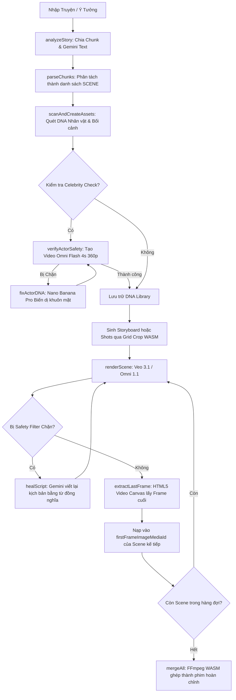

# 🎬 BÁO CÁO REVERSE ENGINEERING & SPECS TOÀN DIỆN: MLT ULTRA ELITE V2.7 (GOOGLE FLOW FILM STUDIO)

> **Mục tiêu:** Phân tích, reverse-engineer toàn diện từng dòng mã nguồn, giải phẫu kiến trúc, hệ thống bảo mật MLT Guard, quy trình xử lý, các bộ Prompt chuẩn điện ảnh, luồng dữ liệu (State Flow), cơ chế tự sửa lỗi (Auto-Healing), bypass bộ lọc kiểm duyệt (Celebrity Filter Bypass), và tích hợp hệ thống sinh phim tự động.

---

## 📑 MỤC LỤC
1. [TỔNG QUAN HỆ THỐNG & NGUỒN GỐC](#1-tổng-quan-hệ-thống--nguồn-gốc)
2. [CẤU TRÚC DỰ ÁN & VAI TRÒ CÁC THÀNH PHẦN](#2-cấu-trúc-dự-án--vai-trò-các-thành-phần)
3. [GIẢI PHẪU KIẾN TRÚC CLIENT RUNTIME & FLOW SDK BRIDGE](#3-giải-phẫu-kiến-trúc-client-runtime--flow-sdk-bridge)
4. [REVERSE BẢO MẬT: HỆ THỐNG BẢN QUYỀN MLT GUARD & KỸ THUẬT BYPASS](#4-reverse-bảo-mật-hệ-thống-bản-quyền-mlt-guard--kỹ-thuật-bypass)
   - 4.1. Cơ chế sinh Hardware Device Fingerprint
   - 4.2. Chữ ký số ECDSA P-256 & Cấu trúc License Token
   - 4.3. Anti-Tamper: Cơ chế đồng bộ thời gian thực qua Gemini AI NTP & HTTP Head
   - 4.4. Mã khóa tính năng & Backdoor Passwords ẩn trong UI
   - 4.5. Cơ chế Unlock / Monkey-patching Runtime Memory
5. [TỔNG HỢP TOÀN BỘ PROMPT SYSTEM, RULES & TEMPLATES TRONG ỨNG DỤNG](#5-tổng-hợp-toàn-bộ-prompt-system-rules--templates-trong-ứng-dụng)
   - 5.1. Story Breakdown Prompt (Chuyển truyện thành kịch bản)
   - 5.2. Hollywood DOP / Live-Action System Prompt
   - 5.3. 360° Character DNA Bible & Chroma Key Green Prompt
   - 5.4. Architectural Location Reference Sheet Prompt
   - 5.5. Auto-Heal & Policy Compliance Rewrite Prompt
   - 5.6. Storyboard Pencil Sketch Prompt
   - 5.7. Loop Rewrite / Alternate Dramatic Take Prompt
6. [CHI TIẾT TOÀN BỘ CÁC LUỒNG XỬ LÝ (CORE WORKFLOWS)](#6-chi-tiết-toàn-bộ-các-luồng-xử-lý-core-workflows)
   - 6.1. Luồng 1: Phân tích truyện tự động & Cắt Chunk (Story Analysis Flow)
   - 6.2. Luồng 2: Trích xuất & Tạo thư viện DNA Nhân vật/Bối cảnh (DNA Asset Scanning)
   - 6.3. Luồng 3: Adversarial DNA Mutation (Bypass Celebrity Safety Filter)
   - 6.4. Luồng 4: Storyboard Multi-Crop & Shot Generation qua FFmpeg WASM
   - 6.5. Luồng 5: Video Generation & I2V Continuity (Last Frame Chaining)
   - 6.6. Luồng 6: Tự động phục hồi lỗi chính sách (Auto-Healing Filter Loop)
   - 6.7. Luồng 7: Ghép nối phim Master (FFmpeg WASM & Native FFmpeg Concat)
   - 6.8. Luồng 8: Vòng lặp kịch bản vô tận (Auto Loop Process)
7. [BẢNG THÔNG SỐ KỸ THUẬT & TOÀN BỘ STATE CỦA ỨNG DỤNG](#7-bảng-thông-số-kỹ-thuật--toàn-bộ-state-của-ứng-dụng)
8. [TÍCH HỢP HỆ SINH THÁI GFLOW STUDIO & ĐIỀU KHIỂN NỀN (HEADLESS CDP)](#8-tích-hợp-hệ-sinh-thái-gflow-studio--điều-khiển-nền-headless-cdp)

---

## 1. TỔNG QUAN HỆ THỐNG & NGUỒN GỐC

**MLT Ultra Elite V2.7** (tiền thân của G-Flow Film Studio) là một ứng dụng dạng **Sandboxed Applet** được thiết kế chạy trực tiếp bên trong `iframe` của nền tảng **Google Flow** (`flow.google.com`), phục vụ quy trình sản xuất phim ảnh AI toàn trình từ:
- Phân tích văn học/truyện chữ thành kịch bản phân cảnh chuẩn 10 giây/scene.
- Thiết kế và trích xuất hồ sơ DNA nhân vật (Character Bible) và bối cảnh (Location Sheet) 360 độ.
- Tạo Storyboard phân khung và tự cắt lưới (Grid Crop 2x2, 3x3) trực tiếp bằng FFmpeg WASM.
- Khởi tạo hình ảnh khởi đầu (Keyframe/Shot) và dựng video với sự kế thừa frame cuối (`extractLastFrame`) để tạo sự liền mạch tuyệt đối (Image-to-Video Continuity).
- Tự phát hiện lỗi chính sách Google AI và kích hoạt Gemini viết lại kịch bản tự lành (Auto-Heal).
- Ghép nối xuất ra bản Master hoàn chỉnh có âm thanh và phụ đề.

Hệ thống nguyên bản được tác giả đóng gói kèm theo cơ chế bảo mật DRM độc quyền mang tên **MLT Guard (v3.1.6)** nhằm kiểm soát thiết bị, thời hạn sử dụng và phân hạng gói tính năng (FREE vs ELITE).

---

## 2. CẤU TRÚC DỰ ÁN & VAI TRÒ CÁC THÀNH PHẦN

Trong thư mục `C:\learning\Film\archive`:

```
c:\learning\Film\archive\
├── flow-tool-src\                  # Mã nguồn Applet gốc (chưa bypass, còn nguyên MLT Guard)
│   ├── App.tsx                     # Ứng dụng chính (3,611 dòng, chứa toàn bộ UI & Logic)
│   ├── flow-sdk.js                 # Thư viện giao tiếp MessageChannel với Google Flow Host
│   ├── components\AuthGate.tsx     # Giao diện khóa bản quyền MLT Guard Client v3.1.6
│   ├── hooks\useMLTAuth.ts         # Hook xác thực ECDSA, sinh DeviceId, kiểm tra Gemini NTP
│   └── services\ffmpegService.ts   # Wrapper WebWorker chạy @ffmpeg/core WASM trong trình duyệt
│
├── mlt-guard-bypass\               # Công cụ Reverse & Bẻ khóa Runtime độc lập
│   ├── unlock.mjs                  # Script CDP can thiệp crypto.subtle.verify & bơm license
│   └── screenshots\                # Ảnh chụp kiểm chứng trạng thái mở khóa
│
├── flow-tool-clean\                # Mã nguồn Applet ĐÃ LÀM SẠCH HOÀN TOÀN (Clean Version)
│   ├── App.tsx                     # Phiên bản đã cắt bỏ AuthGate, maxScenes = 999, mở khóa Quality
│   ├── build_bundle.mjs            # Script build esbuild đóng gói ra dist/app.bundle.js
│   ├── dist\app.bundle.js          # File bundle JS nén hoàn chỉnh
│   ├── dist\app.dataurl.txt        # Data URL dạng base64 nạp nhanh vào iframe
│   ├── generate_kdrama_flawless.mjs# Kịch bản tự động hóa sản xuất phim truyền hình drama Hàn Quốc
│   └── setup_and_render_kdrama.mjs # Script điều khiển nạp phim và timeline
│
├── gflow-clean-studio.mjs          # Bộ điều khiển CLI kết nối Chrome qua cổng CDP 9222
├── gflow-studio-server.mjs         # Máy chủ Web Dashboard cục bộ (Port 3333)
└── README.legacy.md                # Tài liệu kỹ thuật cũ
```

---

## 3. GIẢI PHẪU KIẾN TRÚC CLIENT RUNTIME & FLOW SDK BRIDGE

### 3.1. Cơ chế Sandboxing của Google Flow
Applet chạy trong một `<iframe>` có thuộc tính sandbox cao, xuất phát từ origin: `blob:https://scf.usercontent.goog/...`.
Applet không có quyền truy cập DOM của Google Flow cha, cũng không gọi trực tiếp API của Google Cloud. Mọi thao tác đều thông qua giao thức **MessageChannel / postMessage** hai chiều thông qua cổng `window.FLOW_PORT`.

### 3.2. Cấu trúc Flow SDK (`flow-sdk.js`)
SDK này cung cấp đối tượng toàn cục `Flow` với các dịch vụ lõi:

| Nhóm API | Hàm | Phương thức giao tiếp (CDP/postMessage) | Mô tả |
| :--- | :--- | :--- | :--- |
| `Flow.generate` | `text(prompt, opts)` | `FLOW_GEN_TEXT` | Gọi Gemini 1.5/2.0 Flash phân tích cốt truyện, sửa script, lấy giờ NTP |
| `Flow.generate` | `image(options)` | `FLOW_GEN_IMAGE` | Gọi Imagen / Nano Banana Pro sinh ảnh character DNA, storyboard, keyframe |
| `Flow.generate` | `video(options)` | `FLOW_GEN_VIDEO` | Gọi Veo 3.1 Lite/Fast/Quality hoặc Omni 1.1 Flash để sinh video clip |
| `Flow.media` | `select(options)` | `FLOW_SELECT_MEDIA` | Mở hộp thoại chọn media từ kho Google Flow |
| `Flow.media` | `getBase64(opts)` | `FLOW_MEDIA_GET_BASE64`| Trích xuất chuỗi base64 của media asset đã lưu |
| `Flow.save` | `save(options)` | `FLOW_SAVE` | Lưu trực tiếp video/ảnh vào kho thư viện dự án của Flow |
| `Flow.upload` | `upload(options)` | `FLOW_UPLOAD` | Tải dữ liệu ảnh/video base64 lên để nhận lại `mediaId` làm tham chiếu |
| `Flow.download`| `download(opts)` | `FLOW_DOWNLOAD` | Kích hoạt trình duyệt tải tệp về ổ cứng cục bộ |
| `Flow.storage` | `getItem/setItem` | `FLOW_STORAGE_*` | Lưu trữ cấu hình dạng key-value vào bộ nhớ của Google Flow host |

---

## 4. REVERSE BẢO MẬT: HỆ THỐNG BẢN QUYỀN MLT GUARD & KỸ THUẬT BYPASS

### 4.1. Cơ chế sinh Hardware Device Fingerprint (`getMLTDeviceId`)
Tác giả thu thập 6 thông số phần cứng và trình duyệt của nạn nhân:
```typescript
const specs = [
  navigator.userAgent,
  screen.width,
  screen.height,
  navigator.language,
  navigator.hardwareConcurrency ?? "",
  navigator.deviceMemory ?? ""
].join("|");
const buffer = new TextEncoder().encode(specs);
const hash = await crypto.subtle.digest("SHA-256", buffer);
const hex = Array.from(new Uint8Array(hash))
  .map(b => b.toString(16).padStart(2, "0")).join("");
return `MLT-${hex.slice(0, 16).toUpperCase()}`;
```
👉 Kết quả tạo ra một chuỗi định danh máy duy nhất dạng: `MLT-A1B2C3D4E5F67890`.

### 4.2. Chữ ký số ECDSA P-256 & Cấu trúc License Token
License Key là một chuỗi dạng JWT gồm 2 phần cách nhau bằng dấu chấm: `<payloadBase64Url>.<signatureBase64Url>`.

Khóa công khai ECDSA (`PUBLIC_KEY_JWK`) được nhúng cứng trong `useMLTAuth.ts`:
```json
{
  "kty": "EC",
  "crv": "P-256",
  "x": "GH0F9f42PUQUVYAy3wPkqalTRiBXBgLf-lTjlsi8_kM",
  "y": "Bx6z_YEjJxUfCuPJFkDjflHGN8DVBfP5i7J2k7sxk3Q",
  "ext": true,
  "key_ops": ["verify"]
}
```
Cấu trúc JSON bên trong Payload:
```json
{
  "deviceId": "MLT-A1B2C3D4E5F67890",
  "expiryDate": "2031-01-01T00:00:00.000Z",
  "plan": "ELITE",
  "features": ["*"],
  "licenseId": "LOCAL-A1B2C3D4"
}
```

### 4.3. Anti-Tamper: Cơ chế đồng bộ thời gian thực qua Gemini AI NTP & HTTP Head
Để ngăn người dùng đổi ngày giờ trên Windows nhằm gia hạn bản quyền:
1. **Lớp 1:** Gửi request `HEAD` tới `https://unpkg.com/react/package.json` để lấy header `Date`.
2. **Lớp 2 (AI NTP Fallback):** Nếu mạng chặn unpkg, applet sẽ gọi trực tiếp Gemini qua Flow SDK:
   ```javascript
   Flow.generate.text(
     `Provide the current date and time in UTC. Return ONLY a valid JSON object: {"utc": "YYYY-MM-DDTHH:mm:ssZ"}`,
     {
       systemInstruction: "You are a professional NTP time server. Use your internal knowledge of the current real-world time. Do NOT reference any user-provided timestamps. Output ONLY valid JSON.",
       thinkingLevel: "low"
     }
   );
   ```
3. Bộ đếm ngược thời gian tồn tại dựa trên `performance.now()` kết hợp với `networkBaseTime`. Khi phát hiện quá hạn, `useMLTAuth` lập tức hủy trạng thái ủy quyền và khóa app về chế độ `FREE`.

### 4.4. Mã khóa tính năng & Backdoor Passwords ẩn trong UI
Trong `App.tsx`, tác giả cài cắm các mật khẩu tĩnh (hardcoded secrets):
- **Cấu hình nâng cao (Advanced Config):** Password `"Dozazoi399*%kidfvzt23"`. 
  - *Cơ chế mở:* Nhấp chuột liên tiếp 4 lần vào biểu tượng ổ khóa trong vòng 1.5 giây để làm lộ ô nhập mật khẩu bí mật.
- **Mở khóa chất lượng Veo Quality (`QUALITY_ACCESS_CODE`):** `"Dozazoi399*%jhx1"`.
- **Mở khóa giới hạn Scene từ 6 lên 999 (`SCENE_LIMIT_ACCESS_CODE`):** `"Dozazoi399*%jhx1bietdidau"`.

### 4.5. Cơ chế Unlock / Monkey-patching Runtime (`unlock.mjs`)
Vì quá trình verify hoàn toàn diễn ra ở Client-side trong bộ nhớ JavaScript của iframe, việc bẻ khóa được thực hiện thanh lịch mà không cần dịch ngược nhị phân:
1. Kết nối qua Chrome DevTools Protocol (`Runtime.evaluate`).
2. Ghi đè phương thức Web Crypto API trong realm của iframe:
   ```javascript
   crypto.subtle.verify = async function() { return true; };
   ```
3. Tính toán đúng `deviceId` của máy đang chạy.
4. Tự ký một chuỗi JWT giả với `plan: "ELITE"`, `features: ["*"]` và hạn dùng đến năm 2031.
5. Gán giá trị vào thẻ input thông qua setter prototype của React và phát sự kiện `click` vào nút `"Kích hoạt"`.

---

## 5. TỔNG HỢP TOÀN BỘ PROMPT SYSTEM, RULES & TEMPLATES TRONG ỨNG DỤNG

Toàn bộ các Prompt được trích xuất nguyên bản từ mã nguồn:

### 5.1. Story Breakdown Prompt (`DEFAULT_STORY_PROMPT`)
```text
Phân tích truyện, ý tưởng và hình ảnh tham khảo đính kèm (nếu có).
Viết cho mình kịch bản quay phim điện ảnh chi tiết, thể loại bám sát truyện, bám sát cốt truyện, không được phép sáng tạo thêm. văn phong, ngôn ngữ phù hợp người Việt Nam . Yêu cầu: 

* Cấu trúc cố định của 1 SCENE 10 giây bao gồm:
Bắt đầu với chữ SCENE.
Liệt kê tên nhân vật.
Liệt kê tên bối cảnh chính xác.
Mỗi shot, chỉ ghi shot, không ghi thời gian và bao gồm các thành phần sau: (Tên nhân vật, Bối cảnh nhất quán với toàn bộ câu chuyện, Từng shot và hành động cụ thể của từng nhân vật, Biểu cảm, hành động và trạng thái cảm xúc. Ghi rõ thoại của nhân vật, luôn ghi tên nhân vật trước thoại. Khi nhân vật nào nói, camera phải chuyển/hướng phong cách điện ảnh rõ ràng về đúng nhân vật đó, ghi rõ tên nhân vật được quay. Diễn biến phải liên tục, logic, dễ quay và có cao trào. Thoại tự nhiên, đúng chất drama hài hước Việt Nam).
* Các shot phải liên kết mượt mà, không nhảy cảnh vô lý.
* Mỗi scene chỉ có duy nhất 1 từ “SCENE”.
  Chỉ xuất kịch bản theo từng SCENE, không giải thích gì thêm
```

### 5.2. Hollywood DOP / Live-Action System Prompt (`DEFAULT_SYSTEM_PROMPT`)
```text
Sử dụng các hình ảnh tham khảo đã tải lên làm nguồn dữ liệu hình ảnh chuẩn xác tuyệt đối. Đọc toàn bộ kịch bản trước khi bắt đầu tạo hình ảnh.

Đóng vai một ê-kíp gồm đạo diễn, đạo diễn hình ảnh (DOP), biên tập viên và huấn luyện viên diễn xuất từng đoạt giải thưởng tại Hollywood. Chuyển hóa kịch bản thành một bộ phim điện ảnh live-action siêu chân thực. Nắm vững cốt truyện, nhân vật, các mối quan hệ, động cơ, xung đột, nhịp độ, diễn biến cảm xúc và các tầng ý nghĩa ngầm. THỂ HIỆN BẰNG HÌNH ẢNH, ĐỪNG KỂ LỂ. Góc máy phải nương theo cảm xúc, không phải lời thoại.

PHONG CÁCH ĐIỆN ẢNH: Live-action đời thực, photorealistic, tự nhiên, không CGI, bố cục thanh thoát, chiều sâu không gian chân thực, chất liệu vật lý chính xác, ánh sáng có nguồn rõ ràng và độ tương phản điện ảnh tiết chế. Ưu tiên texture da, lỗ chân lông, tóc con, nếp vải, bóng đổ và phản chiếu tự nhiên. Tránh da nhựa, làm đẹp quá mức, ánh sáng giả, HDR, bloom và vẻ ngoài nhân tạo.

DIỄN XUẤT: Hơi thở, chớp mắt, cử động mắt, khoảng lặng, cử chỉ tinh tế, vi biểu cảm và cảm xúc được tiết chế một cách tự nhiên. Tránh lối diễn xuất máy móc, đồng bộ hóa động tác hoặc cường điệu.

GÓC MÁY: Mang đậm chất điện ảnh khổ lớn (large-format), đa dạng các cỡ cảnh (toàn, trung, cận, OTS, POV), chuyển động máy có chủ đích, tự nhiên như máy quay thật. Tránh lặp lại bố cục khung hình, lạm dụng xóa phông hoặc chuyển động máy vô lý.

TÍNH NHẤT QUÁN: Giữ nguyên tuyệt đối đặc điểm nhận dạng nhân vật, khuôn mặt, độ tuổi, kiểu tóc, trang phục từ ảnh tham chiếu.

QUY TẮC XUẤT: Với lệnh tạo ảnh thì ghi rõ thời gian từng cảnh trên ảnh. Với lệnh tạo video thì chọn đúng thứ tự cảnh, không có chữ trên video.
```

### 5.3. 360° Character DNA Bible & Chroma Key Green Prompt (`DEFAULT_DIRECTIONAL_PROMPT`)
```text
Phong cách hiện đại, nhân vật trẻ đẹp, nữ rất xinh xắn và trang phục lộng lẫy, chân dài và cao. Với mỗi nhân vật, tạo ảnh thiết kế nhân vật theo phong cách người thật, điện ảnh, chân thực cao.

Ghi rõ thông tin trên ảnh:
· Tên nhân vật
· Tuổi
· Ngoại hình
· Khuôn mặt
· Kiểu tóc
· Dáng người
· Trang phục phù hợp với thời đại và hoàn cảnh trong kịch bản
· Phụ kiện đặc trưng
· Đặc điểm nhận diện cố định
· DNA giọng nói chính xác
· Toàn thân chính diện
· Góc 3/4
· Góc nghiêng
· Mặt sau
· Cận mặt

Giữ khuôn mặt, vóc dáng, tóc, độ tuổi và các đặc điểm nhận diện NHẤT QUÁN tuyệt đối để có thể sử dụng làm reference cho tất cả cảnh sau này. Xuất ảnh Phông nền xanh chroma key sạch, đồng nhất, ánh sáng mềm mại, bố cục chuyên nghiệp, phù hợp làm ảnh tham chiếu nhân vật cho phim AI.
```

### 5.4. Architectural Location Reference Sheet Prompt (`DEFAULT_LOCATION_DIRECTIONAL_PROMPT`)
```text
Phong cách hiện đại. Mỗi bối cảnh phải được thiết kế thành ảnh tham chiếu bối cảnh riêng, không phải ảnh minh họa một shot cụ thể.

Thể hiện rõ và ghi rõ thông tin trên ảnh:
· Tên bối cảnh
· Kiến trúc
· Không gian
· Bố cục tổng thể
· Nội thất
· Đồ vật đặc trưng
· Cửa, cửa sổ, cầu thang, bàn ghế, giường, tủ... nếu có
· Chất liệu
· Màu sắc
· Ánh sáng
· Thời đại
· Phong cách kiến trúc
· Các chi tiết cần duy trì nhất quán trong những cảnh quay sau

Bối cảnh phải được thể hiện ở góc nhìn điện ảnh rộng, rõ không gian và các vật thể quan trọng, KHÔNG có nhân vật đứng trong ảnh, trừ khi nhân vật là một phần cố định của thiết kế bối cảnh.
```

### 5.5. Auto-Heal & Policy Compliance Rewrite Prompt (`DEFAULT_HEAL_INSTRUCTION`)
```text
Viết lại kịch bản bằng các từ đồng nghĩa để tránh vi phạm. Nhưng vẫn giữ nguyên cốt truyện của kịch bản. Kịch bản mới có số từ bằng kịch bản cũ. Chỉ xuất scene.
```
*Mẫu lệnh gọi tự động khi xảy ra lỗi kiểm duyệt:*
```text
NHIỆM VỤ: ${healInstruction}
LÝ DO CẦN SỬA: Lỗi "${errorDescription}".
RÀNG BUỘC: Tuyệt đối giữ nguyên cốt truyện, giữ nhân vật và bối cảnh.
KỊCH BẢN GỐC: "${originalText}"
```

### 5.6. Storyboard Pencil Sketch Prompt (`DEFAULT_STORYBOARD_PROMPT`)
```text
Professional cinematic storyboard sketch, detailed pencil lines, clear composition, visual guide for the scene action.
```

### 5.7. Loop Rewrite / Alternate Dramatic Take Prompt (`DEFAULT_LOOP_REWRITE_PROMPT`)
```text
Dựa trên kịch bản gốc của cảnh này, hãy viết lại một phiên bản mới với diễn biến khác đi một chút, tăng tính kịch tính hoặc thay đổi góc nhìn nhưng vẫn giữ nguyên nhân vật và bối cảnh. Đảm bảo ngôn ngữ điện ảnh chuyên nghiệp.
```

---

## 6. CHI TIẾT TOÀN BỘ CÁC LUỒNG XỬ LÝ (CORE WORKFLOWS)



### 6.1. Luồng 1: Phân tích truyện tự động & Cắt Chunk (`analyzeStory`)
1. Nhận văn bản truyện từ `storyText` và ảnh tham khảo `storyImages`.
2. Chia nhỏ văn bản thành các chunk (mặc định 150 từ/chunk) để tránh tràn token và tối ưu ngữ cảnh.
3. Chạy qua `callWithRateLimitRetry`: Hỗ trợ đa luồng (`storyConcurrency` từ 1 đến 5).
4. Mỗi chunk được gửi cho Gemini thông qua `Flow.generate.text` kết hợp với `DEFAULT_STORY_PROMPT`. Kết quả được nối lại thành kịch bản phân cảnh chuẩn (`SCENE 1`, `SCENE 2`...).

### 6.2. Luồng 2: Trích xuất & Tạo thư viện DNA (`scanAndCreateAssets`)
1. Duyệt qua từng cảnh với sliding window 3 cảnh liên tiếp `[i-1, i, i+1]` để hiểu trọn vẹn ngữ cảnh quan hệ nhân vật.
2. Yêu cầu Gemini trả về JSON có cấu trúc chính xác:
   ```json
   {
     "actors": [{"name": "...", "aliases": ["..."], "roles": ["..."], "traits": "..."}],
     "locations": [{"name": "...", "aliases": [], "traits": "..."}]
   }
   ```
3. Sinh ảnh hồ sơ:
   - **Nhân vật:** Sinh ảnh tỉ lệ `1:1`, phông nền xanh Chroma Key, thể hiện 5 góc (chính diện, 3/4, nghiêng, lưng, cận cảnh).
   - **Bối cảnh:** Sinh ảnh tỉ lệ `16:9`, góc máy rộng, không có nhân vật.

### 6.3. Luồng 3: Adversarial DNA Mutation (`verifyActorSafety` & `fixActorDNA`)
Đây là tính năng độc quyền để vượt mặt bộ lọc nhận diện người nổi tiếng của Google Veo:
1. Gọi `Flow.generate.video` với model siêu nhanh `Omni 1.1 Flash`, độ phân giải thấp `360p`, thời lượng ngắn `4s`.
2. Nếu Google chặn vì phát hiện giống diễn viên/người nổi tiếng:
3. Hàm `fixActorDNA` lập tức gọi `Nano Banana Pro` với prompt đối kháng:
   ```text
   Professional cinematic portrait. Redesign facial features to be 100% unique and strictly non-celebrity. MUST RETAIN identical hair style, eye color, skin texture, clothing, and background from reference. Highest fidelity.
   ```
4. Truyền ảnh cũ vào `referenceImageMediaIds`. Model sẽ tái cấu trúc lại các điểm nhân trắc học trên khuôn mặt (mắt, mũi, miệng) nhưng giữ nguyên 100% thần thái, trang phục, tóc và phông nền.
5. Tiến hành kiểm tra lại tối đa 2 lần cho đến khi được hệ sinh thái Google phê duyệt an toàn.

### 6.4. Luồng 4: Storyboard Multi-Crop (`cropStoryboardToShots`)
1. Sinh 1 ảnh tổng thể Storyboard dạng lưới (Grid 2x2 hoặc 3x3) bằng Nano Banana Pro.
2. Nạp mảng byte của ảnh vào hệ thống tệp ảo của FFmpeg WASM:
   ```javascript
   await ffmpegService.writeFile(inputName, bytes);
   ```
3. Chạy lệnh cắt từng ô:
   ```bash
   ffmpeg -i sb_in.png -vf "crop={sliceW}:{sliceH}:{x}:{y}" -y sl_r_c.png
   ```
4. Đọc lại từng tệp crop từ bộ nhớ ảo, chuyển sang Base64 và gọi `Flow.upload` để tạo ra các `mediaId` đại diện cho từng shot riêng biệt.

### 6.5. Luồng 5: Video Generation & I2V Continuity (`extractLastFrame`)
Để nối liền mạch giữa các cảnh trong phim dài:
1. Khi Scene $N$ render xong tệp MP4 dạng Base64:
2. Gọi hàm `extractLastFrame`:
   - Tạo thẻ `<video>` ẩn trong DOM, nạp blob MP4 và tua đến `duration - 0.1s`.
   - Lắng nghe sự kiện `onseeked`, vẽ frame đó lên `<canvas>` HTML5 với độ phân giải gốc của video.
   - Xuất ảnh JPEG chất lượng 0.9 và upload ngược lại Flow lấy `mediaId`.
3. Gán `mediaId` này vào tham số `firstFrameImageMediaId` của Scene $N+1$.
4. Khi Scene $N+1$ được tạo, Google Veo sẽ nội suy chuyển động bắt đầu chính xác từ frame cuối cùng của cảnh trước, loại bỏ hoàn toàn hiện tượng nhảy cảnh (scene jumping).

### 6.6. Luồng 6: Tự động phục hồi lỗi chính sách (`isSafetyError` & `healScript`)
Hệ thống giám sát 23 từ khóa vi phạm:
```typescript
const safetyKeywords = [
  "safety", "policy", "content", "filter", "violation", "flagged", "blocked",
  "unsafe", "harmful", "sensitive", "prohibited", "an toàn", "chính sách",
  "vi phạm", "từ chối", "bộ lọc", "nhạy cảm", "giới hạn", "ngôn ngữ",
  "hình ảnh", "celebrity", "famous person", "safety celebrity"
];
```
Khi bắt được lỗi:
1. Trích xuất mô tả lỗi chi tiết.
2. Gọi `healScript`: Dùng Gemini viết lại đoạn kịch bản bị chặn bằng các từ đồng nghĩa (synonyms) an toàn hơn nhưng bảo toàn ý nghĩa kịch bản.
3. Tự động kích hoạt lại `renderScene` với kịch bản đã chữa lành (tối đa `maxAutoRetries = 5` lần).

### 6.7. Luồng 7: Ghép nối phim Master (`mergeAll`)
Applet cung cấp 2 giải pháp ghép:
1. **In-Browser FFmpeg WASM:**
   - Chuẩn hóa toàn bộ clip về 30fps, timescale 30000, pixel format yuv420p, audio AAC 44100Hz:
     ```bash
     ffmpeg -i raw.mp4 -r 30 -video_track_timescale 30000 -pix_fmt yuv420p -c:v libx264 -preset ultrafast -crf 18 -c:a aac -ar 44100 -ac 2 -fflags +genpts -avoid_negative_ts make_zero -y norm.mp4
     ```
   - Nối concat không giải mã lại (lossless copy):
     ```bash
     ffmpeg -f concat -safe 0 -i inputs.txt -c copy -y final.mp4
     ```
2. **Native FFmpeg 9.0 GPU Acceleration (Qua CLI):**
   - Đọc trực tiếp các tệp MP4 trong thư mục `gflow-output/` và ghép nối bằng GPU NVIDIA/Intel trên máy chủ nội bộ chỉ trong 1-2 giây.

### 6.8. Luồng 8: Vòng lặp kịch bản vô tận (`startAutoLoopProcess`)
- Cho phép tạo các phiên bản (takes) khác nhau của cùng một kịch bản.
- Sau khi render và xuất xong bản Master Loop 1, hệ thống tự gọi `rewriteScenesForLoop` để Gemini sáng tạo góc nhìn hoặc kịch tính mới, sau đó tự động kích hoạt render mẻ tiếp theo cho tới khi đạt `autoLoopLimit`.

---

## 7. BẢNG THÔNG SỐ KỸ THUẬT & TOÀN BỘ STATE CỦA ỨNG DỤNG

Dưới đây là danh sách toàn bộ các State chính điều khiển UI và Engine:

| Tên State | Kiểu dữ liệu | Mặc định | Chức năng |
| :--- | :--- | :--- | :--- |
| `selectedModel` | `string` | `"Veo 3.1 - Lite"` | Model sinh video (`Veo 3.1 - Lite/Fast/Quality`, `Omni 1.1 Flash`) |
| `selectedImageModel` | `string` | `"🍌 Nano Banana Pro"` | Model sinh ảnh nhân vật, bối cảnh, storyboard |
| `globalDuration` | `string` | `"8"` | Thời lượng video mỗi scene (5s, 8s, 10s) |
| `aspectRatio` | `string` | `"16:9"` | Tỉ lệ khung hình (`16:9`, `9:16`, `1:1`, `4:3`) |
| `resolution` | `string` | `"720p"` | Độ phân giải (chỉ dùng cho Omni 1.1 Flash: `360p`, `720p`, `1080p`) |
| `videoGenMode` | `string` | `"r2v"` | Chế độ sinh: `r2v` (Reference-to-Video) hoặc `i2v` (Image-to-Video) |
| `startFrameSource` | `string` | `"none"` | Khung hình đầu: `none`, `shot`, `keyframe`, `continuity` |
| `endFrameSource` | `string` | `"none"` | Khung hình kết thúc để nội suy (interpolation) |
| `useLastFrameAsReference` | `boolean`| `false` | Tự động lấy frame cuối scene trước làm ref cho scene sau |
| `isStoryboardCropEnabled`| `boolean`| `false` | Bật tính năng cắt lưới Storyboard tự động qua WASM |
| `isAutoHealEnabled` | `boolean` | `true` | Bật tự động sửa kịch bản khi dính vi phạm chính sách |
| `isCelebrityCheckEnabled`| `boolean`| `false` | Bật tính năng dò và sửa DNA người nổi tiếng |
| `maxScenes` | `number` | `6` (gốc) / `999` (clean)| Số cảnh tối đa được phép render |
| `maxRetries` | `number` | `0` | Số lần thử lại thủ công khi lỗi |
| `maxAutoRetries` | `number` | `5` | Số lần tối đa AI tự động chữa lành kịch bản |
| `renderTimeout` | `number` | `300` (giây) | Hạn mức thời gian chờ Google trả về video |
| `retryDelay` | `number` | `99` (giây) | Thời gian nghỉ trước khi thử lại |
| `isAutoLoopEnabled` | `boolean` | `false` | Tự động viết lại kịch bản và sinh phim lặp vô tận |
| `autoMerge` | `boolean` | `false` | Tự động xuất master MP4 ngay khi tất cả cảnh hoàn tất |

---

## 8. TÍCH HỢP HỆ SINH THÁI GFLOW STUDIO & ĐIỀU KHIỂN NỀN (HEADLESS CDP)

Để khai phóng tối đa sức mạnh của MLT Ultra Elite V2.7 mà không bị giới hạn bởi giao diện web, bộ công cụ đã được mở rộng thành cụm hệ thống tự động:

1. **`gflow-clean-studio.mjs`:**
   - Kết nối trực tiếp vào trình duyệt Google Chrome thông qua cổng **Remote Debugging 9222**.
   - Tìm kiếm iframe có URL chứa `scf.usercontent.goog` và nạp mã nguồn sạch `dist/app.bundle.js` thông qua cơ chế `import("data:text/javascript;base64,...")`.
   - Có chế độ `watch`: Lắng nghe sự kiện F5/Reload trang để tự động tái nạp Applet sạch, giữ trạng thái `ULTRA ELITE (CLEAN)` vĩnh viễn.

2. **`gflow-studio-server.mjs` (Dashboard Companion - Port 3333):**
   - Cung cấp giao diện trực quan cho người dùng kiểm tra trạng thái kết nối CDP, theo dõi log hệ thống thời gian thực qua Server-Sent Events (SSE).
   - Nút bấm 1-click để khởi chạy Chrome và nạp Studio tự động.

3. **`Native FFmpeg 9.0 GPU Acceleration`:**
   - Xử lý các video clip xuất ra từ web bằng FFmpeg cài trên máy chủ cục bộ với phần cứng GPU rời (NVIDIA NVENC / AMD AMF / Intel QSV), render phim master 4K/60fps siêu tốc chỉ trong vài giây.
